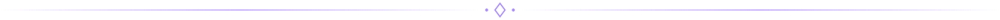
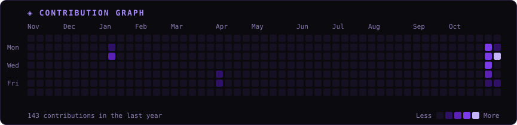

  

  

  
  
  
  

<h2 align="center">⛧ sys.identity ⛧</h2>

  

  
  
  

<h2 align="center">🕷 active directives</h2>

- **Vamp Layout:** Modern architectural layout engine focused on high-performance modular UI components and layout rendering.
- **EMG Bio-Sensor:** Conceptual surface electromyography wearable bracelet for motor rehabilitation and gesture recognition.
- **Source 2 Modding & CV:** Asset extraction via **Source2Viewer**, 3D character pipeline in **Blender**, and hand/facial gesture computer vision tracking R&D in **Python**.
- **Cybersecurity Research:** Applied vulnerability assessment and threat analysis methodologies within academic seedbed workflows.

<h2 align="center">⚙ arsenal</h2>

<h4 align="center">Core Stack</h4>

  

<h4 align="center">Backend & Databases</h4>

  

<h4 align="center">Architecture & Tooling</h4>

  

<h4 align="center">Modding, 3D & Vision</h4>

  

  
  
  
  
  
  
  

<h4 align="center">Environment</h4>

  
  
  
  
  
  
  
  

<h2 align="center">☾ live metrics</h2>

  

  
  

  

<kbd>▦ raw grid</kbd>

 

  

<h2 align="center">⛓ machines</h2>

  

<h2 align="center">♱ audio</h2>

  
   
  sound design · arrangement · mixing
    
  
  
  
  
  

  

