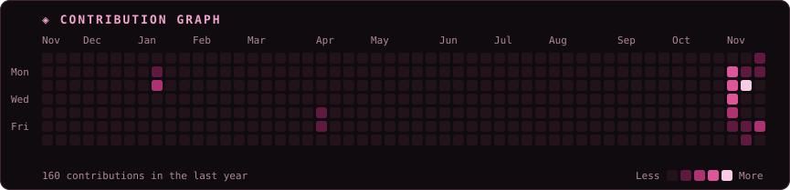

<!-- theme:sakura -->

  

  
   shuffle theme

  

  
  
  
  

<h2 align="center">⛧ sys.identity ⛧</h2>

  

  
  
  
  

<h2 align="center">🕷 active directives</h2>

  

<h2 align="center">arsenal</h2>

  

<h2 align="center">☾ live metrics</h2>

  

  
  

  

<kbd>▦ raw grid</kbd>

 

  

<h2 align="center">⛓ machines</h2>

  

<h2 align="center">♱ audio</h2>

  
   
  sound design · arrangement · mixing
    
  
  
  
  
  

  

